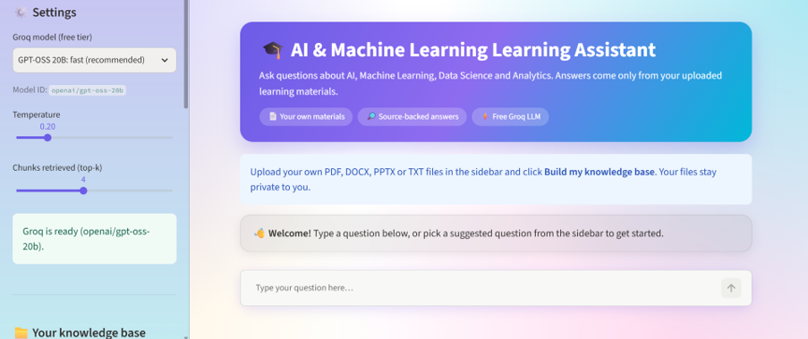
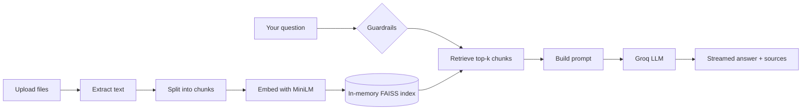

# 🎓 AI & Machine Learning Learning Assistant

A study chatbot that answers questions **only from your own learning materials**. Upload your PDFs, Word files, slides or text notes, ask a question, and get an answer with the exact files and pages it came from.

It uses **Retrieval-Augmented Generation (RAG)**: your documents are split into chunks, the most relevant chunks are found for each question, and a free large language model (via the Groq API) writes the answer from those chunks.



## Features

- **Upload your own materials:** PDF, DOCX, PPTX and TXT files.
- **Private by design:** each visitor's documents are indexed in their own browser session and are never saved on the server or shown to other users.
- **Source-backed answers:** every answer lists the files and pages (or slides) it used.
- **Free LLM:** choose from several free-tier Groq models in a dropdown. No local model download.
- **Free local embeddings:** `all-MiniLM-L6-v2` runs on the machine.
- **Streaming answers** with a clear "could not find this in your materials" reply when nothing relevant is retrieved.
- **Query guardrails:** blocks unsafe prompts and asks for clarification on incomplete or vague questions.
- **Suggested questions**, clear chat, and delete-my-documents buttons.
- **Light and dark mode** friendly interface.

## How it works



1. **Index:** uploaded files are read, split into overlapping chunks, converted to vectors and stored in a FAISS index held in that visitor's session memory.
2. **Ask:** the question passes the guardrails, then the top-k most similar chunks are retrieved. Chunks below a minimum similarity score are discarded.
3. **Answer:** the chunks and question are sent to the selected Groq model, which is instructed to answer only from that material. The answer streams back with its sources.

## Project structure

```
rag_assistant/
├── app.py                  # Streamlit interface (run this)
├── requirements.txt
├── .env.example            # template for your API key
├── .streamlit/
│   └── config.toml         # theme and server settings
└── rag/
    ├── config.py           # all settings and the model list
    ├── loader.py           # reads PDF / DOCX / PPTX / TXT
    ├── vector_store.py     # chunking, embeddings, in-memory FAISS index
    ├── guardrails.py       # safety, incomplete and vague-query checks
    ├── prompts.py          # system prompt and prompt builder
    ├── llm.py              # Groq API client (streaming)
    └── pipeline.py         # guardrails -> retrieve -> prompt -> answer
```

## Getting started

### Requirements
- Python 3.10 or newer
- A free Groq API key from [console.groq.com/keys](https://console.groq.com/keys)

### 1. Clone and enter the project
```bash
git clone https://github.com/YOUR-USERNAME/rag-learning-assistant.git
cd rag-learning-assistant
```

### 2. Create a virtual environment and install packages
Windows (PowerShell):
```powershell
python -m venv .venv
.\.venv\Scripts\Activate.ps1
python -m pip install -r requirements.txt
```
macOS / Linux:
```bash
python3 -m venv .venv
source .venv/bin/activate
python -m pip install -r requirements.txt
```
The first install takes a few minutes because of PyTorch.

### 3. Add your API key
Copy `.env.example` to `.env` and put your key in it:
```
GROQ_API_KEY=your_groq_key_here
```
Never commit the `.env` file. It is already listed in `.gitignore`.

### 4. Run the app
```bash
python -m streamlit run app.py
```
The app opens at http://localhost:8501. The first run also downloads the small embedding model (about 90 MB) automatically.

## Using the app

1. In the sidebar, pick a **Groq model**.
2. **Upload** your PDF, DOCX, PPTX or TXT files and click **Build my knowledge base**.
3. Type a question, or click a suggested question.
4. Read the answer and check the **Sources** list under it.

Sidebar settings:

| Setting | What it does |
|---|---|
| **Temperature** | How strictly the model sticks to the most likely wording. Keep it low (0.0 to 0.3) for factual answers. |
| **Chunks retrieved (top-k)** | How many pieces of your documents the model reads per question. Use more for broad questions and fewer for specific ones. |

## Configuration

Settings live in `rag/config.py`. Most can be overridden with environment variables in your `.env` file:

| Variable | Default | Meaning |
|---|---|---|
| `GROQ_API_KEY` | none | Your Groq API key (required) |
| `GROQ_MODEL` | `openai/gpt-oss-20b` | Model selected by default |
| `MAX_NEW_TOKENS` | `512` | Maximum answer length. Raise it (for example to `1500`) for reasoning models |
| `TEMPERATURE` | `0.2` | Default temperature |
| `TOP_K` | `4` | Default number of retrieved chunks |
| `CHUNK_SIZE` / `CHUNK_OVERLAP` | `800` / `150` | Chunking in characters |
| `MIN_SIMILARITY` | `0.25` | Chunks below this cosine similarity are ignored |
| `EMBEDDING_MODEL` | `sentence-transformers/all-MiniLM-L6-v2` | Embedding model |


## Privacy and security

- Uploaded files are held in memory for your browser session only. Refreshing or closing the page deletes them.
- To produce an answer, the **retrieved text chunks and your question are sent to Groq's API**. Do not upload confidential or sensitive documents.
- Keep your API key in `.env` or your host's secrets settings. Never put it in code or commit it to Git.
- If you deploy the app publicly, everyone shares your one API key and its free-tier rate limit. Restrict access or let users enter their own key.

## Troubleshooting

| Problem | Fix |
|---|---|
| "No API key found" in the sidebar | Check `.env` contains `GROQ_API_KEY=...`, then restart the app. |
| "Model not found" (HTTP 404) | That model is not enabled for your Groq account. Pick another one, or remove it from `GROQ_MODELS`. |
| "Free-tier rate limit reached" | Wait a minute, lower top-k, or lower `MAX_NEW_TOKENS`. |
| Answers are cut off or empty | Raise `MAX_NEW_TOKENS`. Reasoning models use part of the limit for thinking. |
| "I could not find this information..." | The topic may not be in your files. Try a higher top-k or lower `MIN_SIMILARITY`. |
| "Your question is unclear" | Add the topic name to your question (for example, "What is Random Forest?" instead of "What is it?"). |
| PDF gives no text | Scanned PDFs are images. Text extraction needs a text-based PDF (there is no OCR). |
| `Fatal error in launcher` on Windows | The virtual environment was created in a different folder. Recreate it in the current folder and run `python -m streamlit run app.py`. |

## Limitations

- Answers come only from your uploaded files, so there is no general knowledge fallback.
- Smaller models can make mistakes, especially with formulas. Check important answers against the cited source.
- No memory of earlier questions: each question is answered on its own.
- No OCR for scanned documents.

## Deployment notes

The app is hosted on a platform such as Streamlit Community Cloud.

## Tech stack

[Streamlit](https://streamlit.io) · [LangChain](https://www.langchain.com) (loaders, splitter, FAISS wrapper) · [FAISS](https://github.com/facebookresearch/faiss) · [sentence-transformers](https://www.sbert.net) · [Groq API](https://groq.com) · pypdf · python-docx · python-pptx
